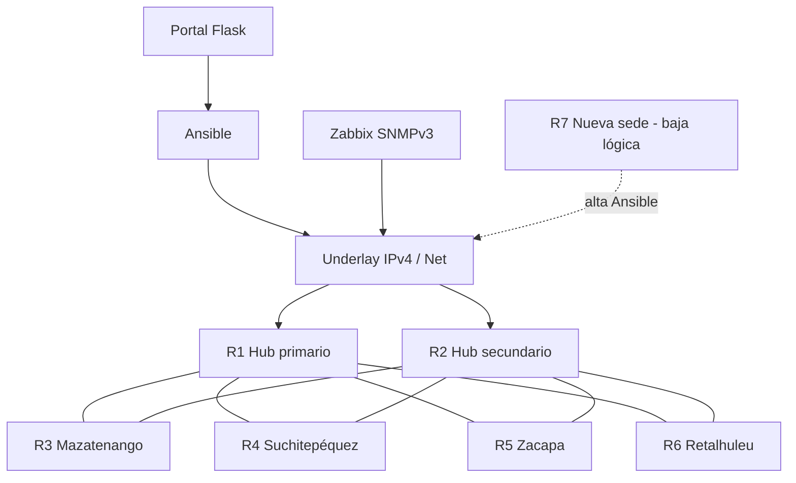

[README.md](https://github.com/user-attachments/files/35128302/README.md)
# Proyecto SDN — DMVPN Dual Hub

Proyecto académico de Software Defined Networking: infraestructura de sucursales redundante, cifrada, automatizada y monitoreada.

## Arquitectura



EVE-NG con Cisco IOL 15.7, DMVPN sobre mGRE/NHRP, IKEv2/IPsec en modo transporte, iBGP AS 65000 y LAN dual stack. El controlador Ansible y Zabbix se ejecutan en Ubuntu; Tailscale proporciona acceso remoto mediante un gateway de subred. El portal Flask utiliza los playbooks existentes.

## Direccionamiento

Underlay: 172.16.0.0/24. Loopbacks: 10.254.0.s/32. LAN IPv4: 10.(24+s).0.0/24. LAN IPv6: 2001:824:s::/64.

| Router | Rol | Underlay | LAN IPv4 | LAN IPv6 |
|---|---|---|---|---|
| R1 | Hub primario | 172.16.0.1 | — | — |
| R2 | Hub secundario | 172.16.0.2 | — | — |
| R3 | Mazatenango | 172.16.0.3 | 10.27.0.0/24 | 2001:824:3::/64 |
| R4 | Suchitepéquez | 172.16.0.4 | 10.28.0.0/24 | 2001:824:4::/64 |
| R5 | Zacapa | 172.16.0.5 | 10.29.0.0/24 | 2001:824:5::/64 |
| R6 | Retalhuleu | 172.16.0.6 | 10.30.0.0/24 | 2001:824:6::/64 |
| R7 | Nueva sede | 172.16.0.7 | 10.31.0.0/24 | 2001:824:7::/64 |

Overlay primario: 10.255.1.0/24 y 2001:824:101::/64 (Tunnel0). Secundario: 10.255.2.0/24 y 2001:824:102::/64 (Tunnel1). R7 permanece dado de baja para la demostración.

## Matriz de cumplimiento y pruebas

Estado preliminar basado en las pruebas realizadas; la incorporación de archivos y evidencias al repositorio está pendiente.

| Requisito | Estado | Implementación / evidencia a incorporar |
|---|---|---|
| IKEv2/IPsec | Validado | R7: asociaciones READY con ambos hubs y cuatro spokes tras generar tráfico |
| DMVPN Dual Hub | Validado | show dmvpn; cuatro spokes originales, cinco tras el alta |
| BGP IPv4/IPv6 | Validado con limitación | 8 sesiones por familia en los hubs; IPv4 dinámico, IPv6 requiere actualización de vecinos en hubs |
| Spoke a spoke | Parcial | Asociaciones directas observadas; falta adjuntar traceroute de aceptación |
| Failover ≤45 s | Pendiente de evidencia cuantitativa | Failover indicado como realizado; adjuntar medición y logs |
| MTU 1400 con DF | Pendiente de evidencia | Prueba de ping extendido |
| IPv6 | Validado entre interfaces LAN | R7 a R3–R6; R3 a R7; adjuntar pruebas de PCs si corresponde |
| Idempotencia alta changed=0 | Pendiente | Segunda ejecución real sin cambios; simulación no demuestra idempotencia |
| Baja de sitio | Parcial | Baja de R7 validada: sin BGP, túneles ni rutas LAN, SSH conservado; falta IPAM y baja automática Zabbix |
| Sitio sorpresa | Parcial | Portal limitado a R7; simulación web validada; alta real web reservada para demostración |
| IPAM persistente | Pendiente | Portal actual sin asignación dinámica ni base de datos IPAM |
| Alta/baja Zabbix por API | Pendiente | Seis routers registrados y monitoreados; falta integración community.zabbix |

## Automatización

Playbooks originales a incorporar: `alta_sucursal.yml`, `baja_sucursal.yml`, `backup_routers.yml`. Plantillas Jinja2 de configuración base e IPsec. Inventario R1–R7. Ansible Vault protege la PSK localmente. El portal ofrece alta, baja, simulación, validación, respaldo y guardado. La simulación desde el navegador y la consulta de R7 fueron probadas; el alta y baja reales se probaron por CLI.

Comandos desde el directorio operativo `~/ansible-sdn`:

```bash
source venv/bin/activate
ansible-inventory --graph
ansible-playbook playbooks/alta_sucursal.yml --ask-pass --ask-vault-pass --check -f 1
ansible-playbook playbooks/alta_sucursal.yml --ask-pass --ask-vault-pass -f 1
ansible-playbook playbooks/baja_sucursal.yml --ask-pass -f 1
```

Los dos últimos modifican la infraestructura. Ejecutarlos únicamente con autorización y respaldos previos. No se incluye el Vault real ni credenciales.

## Monitoreo

Zabbix 7.0, SNMPv3 authPriv, plantilla Cisco IOS by SNMP. Dashboard de disponibilidad, CPU, memoria, latencia, pérdida, tráfico, estado DMVPN, BGP IPv4/IPv6 e IPsec. Mapa con indicadores BGP para ambos hubs. 22 triggers personalizados: 8 BGP IPv4, 8 BGP IPv6 y 6 IPsec.

OID principales:
- BGP IPv4: `1.3.6.1.2.1.15.3.1.2`.
- BGP IPv6 (tabla de vecinos multiprotocolo): `1.3.6.1.4.1.9.9.187.1.2.5.1.3`.
- IPsec activos: `1.3.6.1.4.1.9.9.171.1.3.1.1.0`.

BGP Established = 6. IPsec: mínimo orientativo 4 por hub, 2 por spoke; el conteo no identifica cada peer. Los indicadores muestran últimos valores, no disponibilidad instantánea. CPU 0% observado en IOL requiere validación adicional. El acceso SNMP se realiza por underlay mediante Tailscale, no mediante una FVRF demostrada.

## Comandos de verificación Cisco

```text
show ip interface brief
show ipv6 interface brief
show crypto ikev2 sa
show crypto ipsec sa
show dmvpn
show ip bgp summary
show bgp ipv6 unicast summary
show ip route bgp
show ipv6 route bgp
```

## Estructura prevista del repositorio

- `ansible/`: inventario, playbooks, plantillas y variables de ejemplo.
- `webapp/`: código Flask y frontend (mantener junto al proyecto Ansible al desplegar).
- `routers/`: configuraciones sanitizadas.
- `eveng/`: laboratorio exportado y sanitizado.
- `zabbix/`: exportaciones y procedimientos de monitoreo.
- `tailscale/`: configuración y scripts sin credenciales.
- `documentacion/`: informe y guía de demostración.
- `evidencias/`: capturas y resultados sin secretos.

Las rutas anteriores son el plan de organización, no una afirmación de que los archivos ya están publicados.

## Seguridad y limitaciones

No publicar contraseñas, PSK, claves SNMP, archivos Vault reales, tokens, hashes de autenticación, claves privadas ni imágenes Cisco. Revisar también exportaciones EVE-NG y Zabbix y capturas de terminal. El portal usa autenticación y túnel SSH; es una aplicación de laboratorio con indicadores estáticos y operaciones específicas de R7. La baja lógica conserva acceso administrativo y no revoca individualmente la PSK compartida. El enunciado menciona OSPF en detalles de diseño, pero BGP en entregables y aceptación; se implementó BGP. La implementación no cumple todavía el requisito de hubs sin cambios por sitio para IPv6, ni se ha demostrado FVRF.


## Acceso remoto mediante Tailscale

Se implementó un servidor Ubuntu como Subnet Router
de Tailscale para permitir el acceso remoto a la
infraestructura SDN-DMVPN desarrollada en EVE-NG.

### Documentación y configuración

- [Documentación principal de Tailscale](tailscale/README.md)
- [Script de instalación](tailscale/instalacion.sh)
- [Configuración del gateway](tailscale/configuracion.md)
- [Configuración de Netplan](tailscale/configuraciones/netplan.yaml)
- [Configuración IP Forwarding](tailscale/configuraciones/99-tailscale.conf)
- [Configuración Subnet Router](tailscale/configuraciones/enrutamiento.sh)

Subred anunciada: 172.16.0.0/24.
