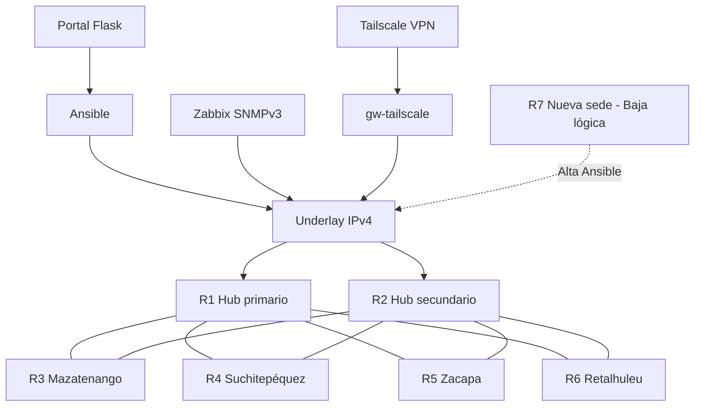

# Proyecto SDN — DMVPN Dual Hub

## Descripción del proyecto

Proyecto académico de Software Defined Networking (SDN)
orientado a implementar una infraestructura de sucursales
redundante, cifrada, automatizada y monitoreada.

La solución integra DMVPN Dual Hub, IKEv2/IPsec, BGP,
IPv4/IPv6, Ansible, Zabbix, Tailscale y un portal web
de administración desarrollado en Flask.

## Tecnologías utilizadas

| Tecnología | Función |
|---|---|
| EVE-NG | Virtualización de infraestructura |
| Cisco IOL 15.7 | Enrutamiento |
| DMVPN | Conectividad entre sucursales |
| IKEv2/IPsec | Cifrado de comunicaciones |
| BGP | Enrutamiento dinámico IPv4 e IPv6 |
| Ansible | Automatización de configuraciones |
| Flask | Portal de administración |
| Zabbix 7.0 | Monitoreo de infraestructura |
| SNMPv3 | Recolección segura de métricas |
| Tailscale | Acceso remoto al laboratorio |
| Ubuntu Server | Plataforma de servicios |

## Arquitectura



La infraestructura utiliza DMVPN sobre mGRE/NHRP,
IKEv2/IPsec en modo transporte, iBGP AS 65000
y redes LAN dual stack.

El acceso remoto se realiza mediante un gateway
Tailscale configurado como Subnet Router.

## Direccionamiento

- Underlay: 172.16.0.0/24
- Loopbacks: 10.254.0.s/32
- LAN IPv4: 10.(24+s).0.0/24
- LAN IPv6: 2001:824:s::/64
- Sistema autónomo BGP: 65000

| Router | Rol | Underlay | LAN IPv4 | LAN IPv6 |
|---|---|---|---|---|
| R1 | Hub primario | 172.16.0.1 | — | — |
| R2 | Hub secundario | 172.16.0.2 | — | — |
| R3 | Mazatenango | 172.16.0.3 | 10.27.0.0/24 | 2001:824:3::/64 |
| R4 | Suchitepéquez | 172.16.0.4 | 10.28.0.0/24 | 2001:824:4::/64 |
| R5 | Zacapa | 172.16.0.5 | 10.29.0.0/24 | 2001:824:5::/64 |
| R6 | Retalhuleu | 172.16.0.6 | 10.30.0.0/24 | 2001:824:6::/64 |
| R7 | Nueva sede | 172.16.0.7 | 10.31.0.0/24 | 2001:824:7::/64 |

### Redes Overlay

| Túnel | IPv4 | IPv6 |
|---|---|---|
| Tunnel0 | 10.255.1.0/24 | 2001:824:101::/64 |
| Tunnel1 | 10.255.2.0/24 | 2001:824:102::/64 |

R7 permanece en estado de baja lógica para
la demostración del proceso de alta automatizada.

## Estructura del repositorio

| Recurso | Contenido |
|---|---|
| [ansible/](ansible/) | Inventario, playbooks y plantillas |
| [eveng/](eveng/) | Laboratorio de EVE-NG |
| [routers/](routers/) | Configuraciones Cisco |
| [tailscale/](tailscale/) | Acceso remoto y configuración VPN |
| [webapp/](webapp/) | Portal Flask |
| [zabbix/](zabbix/) | Monitoreo y configuración |
| [INSTALACION.md](INSTALACION.md) | Guía de instalación |
| [requirements.txt](requirements.txt) | Dependencias Python |

## Instalación

La guía de instalación y preparación del entorno
se encuentra disponible en:

[Guía de instalación del proyecto](INSTALACION.md)

## Automatización mediante Ansible

La automatización utiliza inventario de routers R1–R7,
plantillas Jinja2 y playbooks para administrar
las configuraciones de la infraestructura.

Playbooks principales:

- alta_sucursal.yml
- baja_sucursal.yml
- backup_routers.yml

Ansible Vault protege localmente la PSK utilizada
para el establecimiento de conexiones IPsec.

### Comandos de administración

Desde el directorio operativo ~/ansible-sdn:

```bash
source venv/bin/activate
ansible-inventory --graph
```

Simulación de alta:

```bash
ansible-playbook playbooks/alta_sucursal.yml --ask-pass --ask-vault-pass --check -f 1
```

Alta de sucursal:

```bash
ansible-playbook playbooks/alta_sucursal.yml --ask-pass --ask-vault-pass -f 1
```

Baja de sucursal:

```bash
ansible-playbook playbooks/baja_sucursal.yml --ask-pass -f 1
```

Las operaciones de alta y baja modifican la
infraestructura y requieren autorización
y respaldos previos.

## Portal web

El portal desarrollado en Flask centraliza
las operaciones de administración de la red.

Funciones disponibles:

- Alta de sucursal.
- Baja de sucursal.
- Simulación de configuraciones.
- Validación del estado.
- Respaldo de configuraciones.
- Guardado de configuraciones.

La simulación desde el navegador y la consulta
de R7 fueron validadas. Las operaciones reales
de alta y baja fueron probadas mediante CLI.

El portal administra específicamente R7 y utiliza
los playbooks existentes de Ansible.

## Monitoreo mediante Zabbix

Se implementó Zabbix 7.0 utilizando SNMPv3 authPriv
y la plantilla Cisco IOS by SNMP.

El monitoreo incluye disponibilidad, CPU, memoria,
latencia, pérdida de paquetes, tráfico, DMVPN,
BGP IPv4/IPv6 e IPsec.

Se configuraron 22 triggers personalizados:

- 8 triggers BGP IPv4.
- 8 triggers BGP IPv6.
- 6 triggers IPsec.

### OID utilizados

| Indicador | OID |
|---|---|
| BGP IPv4 | 1.3.6.1.2.1.15.3.1.2 |
| BGP IPv6 | 1.3.6.1.4.1.9.9.187.1.2.5.1.3 |
| IPsec activos | 1.3.6.1.4.1.9.9.171.1.3.1.1.0 |

El estado BGP Established corresponde al valor 6.

Para IPsec se considera un mínimo orientativo
de cuatro asociaciones por hub y dos por spoke.
Este conteo no identifica individualmente cada peer.

Los indicadores representan los últimos valores
recolectados. La lectura de CPU de 0% en Cisco IOL
requiere validación adicional.

El acceso SNMP se realiza mediante la red underlay
utilizando Tailscale.

## Acceso remoto mediante Tailscale

Se implementó un servidor Ubuntu denominado
gw-tailscale como Subnet Router para proporcionar
acceso remoto a la infraestructura EVE-NG.

| Parámetro | Configuración |
|---|---|
| Servidor | gw-tailscale |
| Versión Tailscale | 1.104.6 |
| Interfaz externa | ens33 - DHCP |
| Interfaz interna | ens34 |
| IP interna | 172.16.0.10/24 |
| Subred anunciada | 172.16.0.0/24 |
| IP Forwarding | Habilitado |
| SNAT | Habilitado |

### Documentación de Tailscale

- [README de Tailscale](tailscale/README.md)
- [Script de instalación](tailscale/instalacion.sh)
- [Configuración del gateway](tailscale/configuracion.md)
- [Netplan](tailscale/configuraciones/netplan.yaml)
- [IP Forwarding](tailscale/configuraciones/99-tailscale.conf)
- [Subnet Router](tailscale/configuraciones/enrutamiento.sh)

## Matriz de cumplimiento

La siguiente matriz presenta el estado documentado
de los requisitos técnicos del proyecto.

| Requisito | Estado | Resultado |
|---|---|---|
| IKEv2/IPsec | Validado | Asociaciones establecidas con hubs y spokes |
| DMVPN Dual Hub | Validado | Cuatro spokes originales y cinco tras alta de R7 |
| BGP IPv4/IPv6 | Validado con limitaciones | IPv6 requiere actualizar vecinos en hubs |
| Spoke a spoke | Parcial | Asociaciones directas observadas |
| Failover <=45 segundos | Pendiente de evidencia | Sin medición cuantitativa documentada |
| MTU 1400 con DF | Pendiente de evidencia | Sin resultado documentado |
| IPv6 | Validado entre interfaces LAN | Comunicación R7 y R3–R6 |
| Idempotencia Ansible | Pendiente | Segunda ejecución real no documentada |
| Baja de sitio | Parcial | Baja lógica de R7 validada |
| Sitio sorpresa | Parcial | Simulación web y alta mediante CLI |
| IPAM persistente | Pendiente | Sin base de datos IPAM |
| Alta/baja Zabbix por API | Pendiente | Seis routers registrados manualmente |

## Comandos de verificación Cisco

```text
show ip interface brief
show ipv6 interface brief
show crypto ikev2 sa
show crypto ipsec sa
show dmvpn
show ip bgp summary
show bgp ipv6 unicast summary
show ip route bgp
show ipv6 route bgp
```

## Seguridad

Los archivos del repositorio deben mantenerse
libres de credenciales, contraseñas, PSK reales,
tokens, llaves privadas y archivos Vault reales.

El portal utiliza autenticación y acceso
remoto mediante túnel SSH.

La baja lógica de una sucursal conserva
el acceso administrativo y no revoca
individualmente la PSK compartida.

## Limitaciones de la implementación

- El proyecto utiliza BGP como protocolo de
  enrutamiento dinámico.
- IPv6 requiere actualizar los vecinos BGP
  de los hubs al incorporar una nueva sede.
- No se ha demostrado una implementación FVRF.
- El portal corresponde a un entorno académico
  con operaciones específicas para R7.
- Los indicadores del portal son estáticos.

## Conclusión

El proyecto integra tecnologías de redes,
seguridad, automatización, monitoreo y acceso
remoto dentro de una infraestructura virtualizada.

La organización del repositorio permite consultar
los componentes de manera independiente y facilita
la reproducción y evaluación de la implementación.
